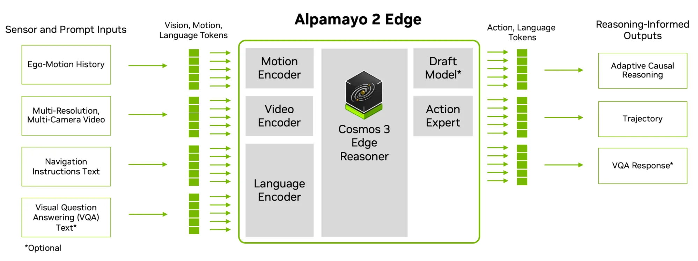

<!-- SPDX-FileCopyrightText: Copyright (c) 2026 NVIDIA CORPORATION & AFFILIATES. All rights reserved. -->
<!-- SPDX-License-Identifier: Apache-2.0 -->

<div align="center">

# Alpamayo 2 Edge

[](https://huggingface.co/nvidia/Alpamayo2-Edge)
[](./LICENSE)

</div>

NVIDIA Alpamayo 2 Edge is a 2B-parameter reasoning vision-language-action model that
uses adaptive reasoning to generate driving trajectories and causal explanations.
Built on the Nemotron-based backbone of NVIDIA Cosmos 3 Edge, it supports fine-tuning
and efficient in-vehicle deployment on NVIDIA DRIVE AGX Thor.

This repository provides standalone PyTorch inference for the released checkpoint.
Given six-camera observations, ego history, and a navigation instruction, the model
generates driving reasoning and 64 future poses at 0.1-second intervals.

<p align="center">
  
</p>

## Table of Contents

- [Prerequisites](#prerequisites)
- [Setup](#setup)
- [Run a PhysicalAI-AV navigation example](#run-a-physicalai-av-navigation-example)
- [Notebook inference](#notebook-inference)
  - [Freeform VQA](#freeform-vqa)
- [Download the model for local use](#download-the-model-for-local-use)
- [Sampling settings](#sampling-settings)
- [Dataset input profile](#dataset-input-profile)
- [Python API](#python-api)
- [Accelerated inference](#accelerated-inference)
- [Tests](#tests)
- [Contributing](#contributing)
- [Support](#support)
- [License](#license)

## Prerequisites

- A Linux host with an NVIDIA GPU, BF16 support, and a compatible CUDA driver.
  We recommend **at least 16 GB of GPU memory** for the provided BF16 examples.
  Larger inputs or more trajectory candidates can require more memory.
- Python 3.12.
- [`uv`](https://docs.astral.sh/uv/getting-started/installation/) for environment management.
- Access to
  [Alpamayo 2 Edge](https://huggingface.co/nvidia/Alpamayo2-Edge) and
  [PhysicalAI-Autonomous-Vehicles](https://huggingface.co/datasets/nvidia/PhysicalAI-Autonomous-Vehicles)
  on Hugging Face.
- For accelerated inference: FlashAttention 2. See the
  [acceleration requirements](docs/acceleration.md#requirements).

## Setup

Run these commands from the repository root. Dependencies pin PyTorch 2.8.0,
torchvision 0.23.0, and Transformers 5.17.0, which provides the Cosmos3-Edge backbone.

```bash
export UV_PROJECT_ENVIRONMENT=.venv
uv sync --locked --dev
source .venv/bin/activate
```

`UV_PROJECT_ENVIRONMENT` selects the environment used by the commands below.
Check the CLI and CUDA environment before loading the model:

```bash
python -m alpamayo2_edge.inference --help
python - <<'PY'
import sys
import torch

print("python:", sys.executable)
print("torch:", torch.__version__)
print("cuda_runtime:", torch.version.cuda)
print("cuda_available:", torch.cuda.is_available())
if torch.cuda.is_available():
    print("device:", torch.cuda.get_device_name(0))
    print("bf16_supported:", torch.cuda.is_bf16_supported())
PY
```

For the default GPU inference path, `cuda_available` and `bf16_supported` must be `True`.

The default attention backend is PyTorch SDPA; installation does not build
FlashAttention. FlashAttention 2.8.3 is an optional `flash` extra for environments
with compatible CUDA build prerequisites. To select it after installation, pass
`--attn-implementation flash_attention_2`. A different backend or runtime can
change sampled text and trajectories.

## Run a PhysicalAI-AV navigation example

Install the optional dataset dependency and authenticate with a
Hugging Face account that has access to both the checkpoint and
[PhysicalAI-Autonomous-Vehicles](https://huggingface.co/datasets/nvidia/PhysicalAI-Autonomous-Vehicles).
The dataset requires accepting its access terms on Hugging Face.

```bash
uv sync --locked --extra dataset --dev
source .venv/bin/activate
hf auth login

python -m alpamayo2_edge.inference \
    --model-id nvidia/Alpamayo2-Edge \
    --revision f8951d095de3589b3face1dec3f4394c8ecedb38 \
    --manifest examples/nav_samples.json \
    --output outputs/physicalai-nav
```

This downloads the model and loads camera images and ego history through the
PhysicalAI-AV SDK. The [example manifest](examples/nav_samples.json) selects clip
`ea7bbd31-b7a5-4972-8dbd-7089e6b53de4` at 4.0 seconds with the navigation
instruction `Turn right in 30m`.

For a local checkpoint and an explicitly selected clip:

```bash
python -m alpamayo2_edge.inference \
    --model-id /path/to/Alpamayo2-Edge \
    --clip-id ea7bbd31-b7a5-4972-8dbd-7089e6b53de4 \
    --t0-us 4000000 \
    --nav-text "Turn right in 30m" \
    --output outputs/physicalai-nav
```

`--manifest` selects index 0 by default; use `--sample-index` for other entries.
Each entry supplies `clip_id`, `t0_us`, and `nav_text`. Use `--nav-text` to override
the selected entry's navigation instruction. Direct `--clip-id` input requires
`--nav-text`; `--t0-us` defaults to 5,100,000 microseconds when omitted.

The loader reads six cameras using the 22-frame schedule below and 20 historical
ego poses in the ego frame at `t0`. It retains actual decoded image timestamps in
clip-relative microseconds and does not query future poses. The existing Edge
processor then builds the prompt and model inputs. Hugging Face access and
streaming are handled by `physical-ai-av`; `HF_HUB_CACHE` can select its cache
location. `--local-files-only` controls model loading only. Output records include
the clip, time, navigation text, and resolved dataset revision.

## Notebook inference

The [demo notebook](notebooks/inference.ipynb) runs the same example step by step: it
shows the 22 camera inputs, runs six reasoning continuations, prints the reasoning and
plots the predicted trajectories in a bird's-eye view. The `notebook` extra includes
the PhysicalAI-AV SDK, Jupyter, and matplotlib. From the repository root:

```bash
uv sync --locked --extra notebook
source .venv/bin/activate
hf auth login
jupyter lab notebooks/inference.ipynb
```

Select the `Python 3 (ipykernel)` kernel from this environment.
Run the cells in order. Set `MODEL_ID` to a local model directory to use downloaded weights.

`uv lock` updates the lockfile. Run `uv sync --locked --extra notebook` to install
the locked notebook dependencies.

The optional accelerated inference section also plots the trajectories from its
final timed call. Candidate numbers match the reasoning shown above each plot.

### Freeform VQA

The notebook's freeform VQA section answers a question about the same scene.
It loads separate VQA inputs with `load_physical_aiavdataset_vqa`.
This notebook example uses six cameras with four frames per camera, for 24 images in total.

Set `QUESTION` in the VQA section. Set `MAX_VQA_TOKENS` to limit the answer length.
For example, ask how the ego vehicle should drive or which hazards are visible.
The VLM generates text without trajectory diffusion. The prompt contains camera
names, time labels, images, and the question.

## Download the model for local use

Authenticate using `hf auth login` or an existing `HF_TOKEN`, then download the
immutable revision. The repository contains both model shards, tokenizer and
processor assets, configuration, and a model card template. Allow approximately
5.3 GB of disk space for the model. Examples stay in this GitHub repository and
their image data is loaded separately from PhysicalAI-AV.

```bash
python - <<'PY'
from huggingface_hub import snapshot_download

snapshot_download(
    repo_id="nvidia/Alpamayo2-Edge",
    revision="f8951d095de3589b3face1dec3f4394c8ecedb38",
    local_dir=".work/Alpamayo2-Edge",
)
PY

export EDGE_MODEL="$PWD/.work/Alpamayo2-Edge"
```

`$EDGE_MODEL` is the model directory itself. The loader resolves all tokenizer
and processor assets from that directory, without fetching a separate backbone.
The released configuration uses the standalone `alpamayo2_edge` model identifiers.

## Sampling settings

Run the public navigation example using the downloaded model:

```bash
python -m alpamayo2_edge.inference \
    --model-id "$EDGE_MODEL" \
    --manifest examples/nav_samples.json \
    --output outputs/local-model
```

Inference generates one reasoning continuation and one trajectory by default.
To generate six independent candidates:

```bash
python -m alpamayo2_edge.inference \
    --model-id "$EDGE_MODEL" \
    --manifest examples/nav_samples.json \
    --num-traj-sets 1 --num-traj-samples 6 \
    --output outputs/six-independent-trajectories
```

`--model-id` accepts either a local directory or a Hugging Face repository ID.
Use `--revision` to select an immutable HF snapshot. Other options include
`--seed`, `--diffusion-steps`,
`--max-generation-length`, `--device`, and `--dtype`; see `--help`.

The driving prompt ends with an empty `<think></think>` block. The model writes its
driving reasoning directly. The decoded `cot` omits that block.

Each sample's output directory contains `output.safetensors` with `pred_xyz`,
`pred_rot`, and generated token IDs; `output.json` with decoded text and shape
checks; `packed.safetensors` with the actual model inputs; and `prompt.txt` with the
fused prompt. `report.json` in the output root records runtime versions, attention
backend, sampling settings, and checkpoint loading diagnostics. With
`--num-traj-sets 6 --num-traj-samples 1`, positions have shape `[1, 6, 1, 64, 3]`
and rotations have shape `[1, 6, 1, 64, 3, 3]`.

## Dataset input profile

This is the recommended data loading setup for CoC-traj inference, which generates
driving reasoning and predicts future trajectories.

`load_physical_aiavdataset` returns an in-memory dictionary for
`prepare_model_inputs`, including these tensors:

| Field | Dtype | Shape | Meaning |
| --- | --- | --- | --- |
| `image_frames` | `uint8` | `[22, 1, 3, H, W]` | Contiguous CPU RGB images; the public example uses 1080 × 1920. |
| `camera_indices` | `int64` | `[22]` | Camera ID for each image. |
| `absolute_timestamps` | `int64` | `[22]` or `[22, 1]` | Captured image timestamps in clip-relative microseconds. |
| `ego_history_xyz` | Floating point | `[1, 20, 3]` | Twenty finite ego positions. |
| `ego_history_rot` | Floating point | `[1, 20, 3, 3]` | Corresponding finite rotation matrices. |

The loader transforms history poses into the ego frame at `t0`. They span −1.9
through 0 seconds at 0.1-second intervals and produce 57 delta tokens.
`prepare_model_inputs` adds the model's leading batch dimension. The loader uses
the following camera counts and sampling profile:

| Cameras | Images per camera | Intended image offsets (seconds) | Pixel budget (min–max) |
| --- | --- | --- | --- |
| 1, 6: front and front telephoto | 5 | −2, −1, −0.5, −0.1, 0 | 163840–196608 |
| 0, 2, 3, 5: remaining cameras | 3 | −1, −0.1, 0 | 81920–98304 |

Actual capture timestamps may have sensor jitter. Preprocessing sorts images by
camera and timestamp together, renders relative-time labels, resizes in `uint8`
with bicubic interpolation, and applies the checkpoint's normalization. Frame
ordering, timestamps, and per-camera pixel budgets are part of the model input.

The dictionary also contains the supplied navigation instruction in `nav_text`
as a one-element list, the per-camera `camera_pixel_bounds`, and source provenance.
The loader requires an explicit, nonempty navigation instruction and does not
load future trajectory labels.

## Python API

```python
import torch

from alpamayo2_edge.checkpoint import load_model
from alpamayo2_edge.helper import prepare_model_inputs, to_device
from alpamayo2_edge.load_physical_aiavdataset import load_physical_aiavdataset

sample = load_physical_aiavdataset(
    "ea7bbd31-b7a5-4972-8dbd-7089e6b53de4",
    t0_us=4_000_000,
    nav_text="Turn right in 30m",
)
model, loading_info = load_model(
    "nvidia/Alpamayo2-Edge",
    revision="f8951d095de3589b3face1dec3f4394c8ecedb38",
    device="cuda",
)
inputs = to_device(prepare_model_inputs(sample, model.config, model.tokenizer), device="cuda")
torch.manual_seed(43)
with torch.inference_mode(), torch.autocast("cuda", dtype=torch.bfloat16):
    xyz, rotations, _, extra = model.sample_trajectories_from_data(
        inputs,
        num_traj_sets=6,
        num_traj_samples=1,
        max_generation_length=256,
        diffusion_kwargs={
            "inference_step": 10,
            "generator": torch.Generator(device="cuda").manual_seed(43),
        },
        return_extra=True,
    )
```

This uses the dataset extra and Hugging Face access described above. An optional
`avdi` argument to `load_physical_aiavdataset` accepts an existing
`PhysicalAIAVDatasetInterface`, allowing a chosen dataset revision/cache to be
reused across multiple clips. `load_model` also accepts a local model directory.

`load_model` rejects missing, unexpected, or mismatched checkpoint parameters.
The third model return value is a placeholder log probability and should not be
used to rank candidates. The CLI checks trajectory shapes and finite values.

## Accelerated inference

You can opt-in basic speedups using `torch.compile`, CUDA graphs, FA2 and kernal auto-tuning.
Install FlashAttention 2 first ([details](docs/acceleration.md#requirements)),
then add `--accel tuned`:

```bash
python -m alpamayo2_edge.inference \
    --model-id "$EDGE_MODEL" \
    --manifest examples/nav_samples.json \
    --accel tuned \
    --output outputs/accelerated
```

- `--accel compile` or `--accel tuned` runs the prompt prefill, CoT decoding
  (including sampling) and the flow-matching loop with `torch.compile` and CUDA
  graphs; the vision encoder runs eagerly. `tuned` also autotunes the decode
  step. The first input compiles and captures the graphs; later inputs with the
  same shapes replay them. Without FlashAttention 2, `--accel` stops with an
  error.
- `--accel-attention` selects the attention kernel inside the prefill graph. The
  default `auto` uses FlashAttention 3 on Hopper when it is installed, otherwise
  PyTorch SDPA.

Caveats:

- The first call for each new input shape compiles and captures graphs inline.
  Set `TORCHINDUCTOR_CACHE_DIR` and `TRITON_CACHE_DIR` to keep the compiler cache
  across processes.
- Graph shapes are static. A new image resolution, a prompt that crosses a
  256-token bucket, or a different CoT count, generation length or sampling
  setting builds new graphs on first use;
  [warm up](docs/acceleration.md#compilation-shapes-and-memory) to keep them out
  of live operation.
- With several CoTs, the prefill runs eagerly and the expert graph replays only
  when all CoTs have the same length.
- Accelerated outputs are not bitwise identical to the default path: compiled
  kernels round BF16 differently, which can change a sampled token where two
  candidates are nearly tied.

The [acceleration guide](docs/acceleration.md) covers requirements, the Python
API and which calls are graphed. For further acceleration and export to NVIDIA DRIVE AGX Thor,
please see [alpamayo-recipes](https://github.com/NVlabs/alpamayo-recipes).

## Tests

Run the tests from the repository root with the environment from Setup:

```bash
source .venv/bin/activate
python -m pytest
```

Checkpoint-specific tests run when `ALPAMAYO2_EDGE_CHECKPOINT` points to a local
model directory. For example, use the model downloaded above:

```bash
ALPAMAYO2_EDGE_CHECKPOINT="$EDGE_MODEL" python -m pytest
```

These tests check the checkpoint configuration and tokenizer inputs. They do not
run full model inference. CUDA graph tests require a CUDA GPU and FlashAttention 2.
Tests with unavailable prerequisites are skipped.

For a full inference check, run the
[PhysicalAI-AV navigation example](#run-a-physicalai-av-navigation-example).
It checks trajectory shapes and finite values, then writes the outputs and `report.json`.

## Contributing

See [CONTRIBUTING.md](CONTRIBUTING.md) for development setup, checks, and pull request instructions.

## Support
📣 **Usage questions and discussion**: please join us on [Alpamayo NV Developer Forum](https://forums.developer.nvidia.com/c/autonomous-vehicles/alpamayo/766).

🐛 **Code-level bugs, documentation issues, and feature requests**: file a [GitHub issue](../../issues/new/choose) using the appropriate template (Bug report, Documentation request, or Feature request). The relevant NVIDIA responder is auto-assigned via the `assignees:` field on the template.

🚨 **Security vulnerabilities**: follow [SECURITY.md](SECURITY.md) to report them privately to NVIDIA. Do not report vulnerabilities in public issues, discussions, or pull requests.

## License

Source code as provided in this repository: Apache License 2.0 - see [LICENSE](LICENSE) for details.

Model weights on Huggingface [nvidia/Alpamayo2-Edge](https://huggingface.co/nvidia/Alpamayo2-Edge) are released under the [OpenMDW-1.1](https://openmdw.ai/license/1-1/) license.